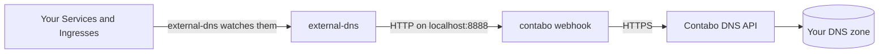

# external-dns-contabo-webhook

[](https://github.com/hayone1/external-dns-contabo-webhook/actions/workflows/ci.yml)
[](https://github.com/hayone1/external-dns-contabo-webhook/actions/workflows/e2e.yml)
[](https://github.com/hayone1/external-dns-contabo-webhook/releases)
[](https://hub.docker.com/r/hayone/external-dns-contabo-webhook)
[](https://scorecard.dev/viewer/?uri=github.com/hayone1/external-dns-contabo-webhook)
[](LICENSE)

Make Kubernetes keep your **Contabo DNS** records up to date, all by itself.

You add a hostname to a Service or Ingress in Kubernetes. A few seconds later,
the DNS record shows up in your Contabo DNS zone. Change the Service and the
record changes. Delete it and the record goes away.

## What is this?

[ExternalDNS](https://github.com/kubernetes-sigs/external-dns) is a popular
Kubernetes tool. It watches your cluster and writes DNS records for you.
It knows how to talk to many DNS companies, but not to Contabo.

This project fills that gap. It is a small **webhook**: a helper program that
runs next to external-dns (in the same pod) and translates its requests into
calls to the [Contabo API](https://api.contabo.com/).



## Features

- Creates, updates and deletes **A, AAAA, CNAME and TXT** records. **MX, SRV
  and CAA** work too, if you use them through external-dns.
- Works with every Contabo zone in your account, or only the ones you pick.
- Safe to restart and safe to retry: creating something that exists, or
  deleting something that is gone, is not an error.
- One bad record does not block the others.
- Stays within Contabo's rate limit and retries when Contabo is busy.
- Never changes Contabo's own NS and SOA records, and never creates or deletes zones.
- Small and locked down: a 30 MB image with no shell, running as a non-root
  user. Images for `amd64` and `arm64`, signed with cosign.
- Prometheus metrics and health checks built in.
- Tested on every change in a real cluster with real external-dns, against a
  fake Contabo API that copies the real one's quirks. Maintainers also test
  against the real Contabo API before releases.

## Quick start

You need: a Kubernetes cluster, [Helm](https://helm.sh/), a Contabo account,
and a domain.

**1. Put your domain on Contabo DNS.** Create a DNS zone for it in the
[Contabo panel](https://my.contabo.com/dns). Then, at the company where you
bought the domain (your registrar), change the domain's nameservers to:

```text
ns1.contabo.net
ns2.contabo.net
ns3.contabo.net
```

**2. Get API credentials.** Open [my.contabo.com/api/details](https://my.contabo.com/api/details).
You need four values: Client ID, Client Secret, API User (your email) and
API Password. Set the API password on that page if you never did.

**3. Save them in Kubernetes.**

```sh
kubectl create namespace external-dns
kubectl -n external-dns create secret generic contabo-credentials \
  --from-literal=client-id='INT-12345678' \
  --from-literal=client-secret='your-client-secret' \
  --from-literal=api-user='you@example.com' \
  --from-literal=api-password='your-api-password'
```

**4. Install external-dns with the webhook.** Download
[deploy/helm/values.yaml](deploy/helm/values.yaml), replace `example.com`
with your domain and `my-cluster` with a name for your cluster, then:

```sh
helm repo add external-dns https://kubernetes-sigs.github.io/external-dns/
helm upgrade --install external-dns external-dns/external-dns \
  --namespace external-dns -f values.yaml
```

**5. Try it.** Add a hostname to any Service:

```sh
kubectl annotate service my-app \
  external-dns.kubernetes.io/hostname=app.example.com
```

Wait a minute, then check: `dig +short app.example.com @ns1.contabo.net`

The full guide, with every option explained, is in [docs/deployment.md](docs/deployment.md).

## Three settings you should not skip

These are already in the example values file. Here is why they matter:

| Setting | Why |
|---|---|
| `txtPrefix: "extdns-%{record_type}."` | external-dns writes a small TXT record next to each record to remember that it owns it. Without this prefix, the TXT record for your bare domain (`example.com`) would be named `a-example.com`, which is outside your zone. external-dns could then never clean up that record. |
| `--txt-wildcard-replacement=wildcard` | Contabo does not allow `*` in the middle of a name, so the TXT record for `*.example.com` needs a different name. |
| `--webhook-provider-read-timeout=30s` and `--webhook-provider-write-timeout=60s` | Contabo allows about 10 to 15 requests per second. A big batch of changes takes longer than external-dns waits by default (15 seconds). |

## Good to know

- **Use the new annotation prefix.** external-dns v0.23 and newer read
  `external-dns.kubernetes.io/hostname`. The old `external-dns.alpha.kubernetes.io/`
  prefix only works if you start external-dns with `--enable-legacy-annotation-prefix`.
- **Only public IP addresses.** Contabo refuses A and AAAA records that point to
  private addresses like `10.x.x.x` or `192.168.x.x`. The webhook skips them
  and logs a warning, so they never block your other records. If your load
  balancer only has a private IP, set the
  `external-dns.kubernetes.io/target` annotation to your public IP.
- **No NS or PTR records.** Contabo does not let you change these through the
  zone API. Reverse DNS (PTR) is a separate Contabo feature.
- **No weighted or geo routing.** Contabo has no such feature, so endpoints
  with a `set-identifier` are skipped.

## Documentation

| Read this | When you want to |
|---|---|
| [Deployment guide](docs/deployment.md) | install, upgrade or remove the webhook |
| [Configuration](docs/configuration.md) | see every setting |
| [How it works](docs/how-it-works.md) | understand what happens to your records |
| [Troubleshooting](docs/troubleshooting.md) | fix something that does not work |
| [Metrics and health checks](docs/metrics.md) | monitor the webhook |
| [Contabo API notes](docs/contabo-api.md) | know the Contabo API's surprises |
| [Development](docs/development.md) | build, test or change the code |
| [Releasing](docs/releasing.md) | publish a new version (maintainers) |

## Images

The same signed image is on two registries. Pick one:

```text
ghcr.io/hayone1/external-dns-contabo-webhook:<version>
docker.io/hayone/external-dns-contabo-webhook:<version>
```

See the [releases page](https://github.com/hayone1/external-dns-contabo-webhook/releases)
for versions. Always pin a version; do not use `latest` in production.

## Contributing

Help is welcome. Start with [CONTRIBUTING.md](CONTRIBUTING.md). AI coding
agents should read [AGENTS.md](AGENTS.md).

Found a security problem? Please report it privately, as described in
[SECURITY.md](SECURITY.md).

## License

[Apache License 2.0](LICENSE). You may use, copy, change and share this
project for free, also in commercial products. Keep the copyright notice and
the [NOTICE](NOTICE) file when you do.

This project is not made by or connected to Contabo GmbH or the Kubernetes project.
